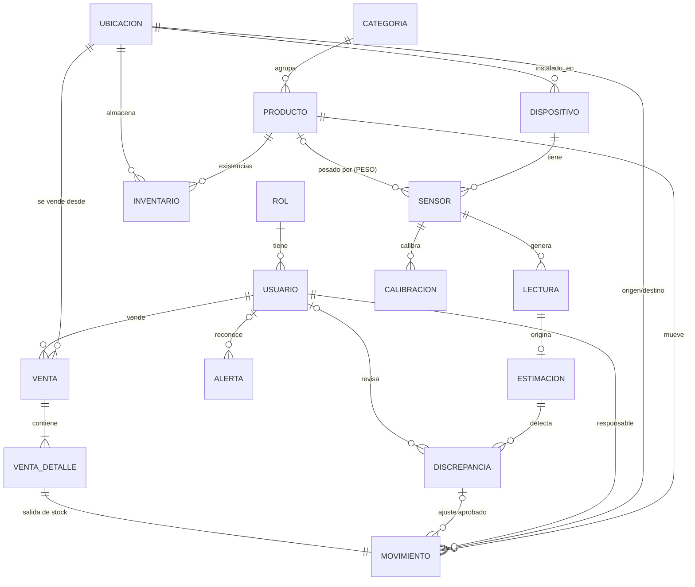

# SmartStock IoT

**Sistema Inteligente de Inventario mediante Internet de las Cosas**
Autor: **Brayan (BR)** · Ingeniería de Software y Sistemas, UNAJ · Versión 2.1.0

Un ESP32 con sensores (DHT22 y celda de carga con HX711) envía mediciones a una API REST en Spring Boot. Las mediciones se guardan en PostgreSQL y se muestran en un dashboard web. El sistema compara el inventario estimado por peso con el inventario registrado y pide **revisión humana** antes de ajustar el stock. Incluye punto de venta con comprobantes, asistente por voz, control de ventilación y reportes.

Se distribuye de tres formas: **instalador de Windows** (aplicación de escritorio con Java incluido), **contenedor Docker** (servidor) y **código fuente** (desarrollo).

---

## 1. Funcionalidades

| Módulo | Qué hace |
|---|---|
| Dashboard | Indicadores, gráficos de temperatura, humedad y peso, últimas lecturas, dispositivos y alertas (actualización cada 5 s) |
| Productos | Catálogo con categorías, precio, peso unitario y stock mínimo; desactivación lógica |
| Inventario | Entradas, salidas, transferencias y ajustes (solo ADMIN) con historial inmutable |
| **Ventas** | Punto de venta: carrito, boleta / factura / nota de venta con correlativo, IGV incluido, vuelto, comprobante imprimible, anulación con devolución de stock, resumen del día y más vendidos |
| Dispositivos IoT | Alta de ESP32 y sensores, claves por dispositivo, calibración de la balanza, control del ventilador |
| Alertas y reportes | Alertas con deduplicación y cierre automático, discrepancias peso vs. stock, auditoría y reportes CSV |
| **Asistente IA** | IA local sin internet con acceso completo al programa (consultas, operaciones con confirmación, pantallas, reportes), voz, memoria y aprendizaje en la marcha; predicción de agotamiento (ver sección 11) |
| Instalación | Asistente de primer arranque que crea el usuario y la base de datos en PostgreSQL |

---

## 2. Instalación

### Opción A — Instalador de Windows (recomendada para usuarios)

1. Instale **PostgreSQL 16 o superior** (<https://www.postgresql.org/download/windows/>) y recuerde la contraseña del usuario `postgres`.
2. Ejecute `SmartStock-IoT-2.1.0-instalador.exe`. No requiere permisos de administrador ni tener Java instalado.
3. Abra **SmartStock IoT**. La primera vez aparece el **asistente de configuración**:
   - pide la contraseña de `postgres` (se usa una sola vez y no se guarda);
   - crea el usuario de base de datos `smartstock` (sin privilegios de superusuario) con una clave aleatoria y la base `smartstock`; si la base ya existía, conserva sus datos y le transfiere la propiedad;
   - define las contraseñas de los usuarios `admin` y `operador`;
   - genera la clave del dispositivo ESP32-01 y la muestra para copiarla en el firmware.
4. Ingrese con `admin` y la contraseña elegida.

La configuración queda en `%USERPROFILE%\.smartstock\application.properties` y el registro en `%USERPROFILE%\.smartstock\smartstock.log` (ambos accesibles desde el menú Inicio). Si PostgreSQL no responde al iniciar, el programa ofrece volver a configurar.

También se genera `SmartStock-IoT-2.1.0-portable.zip`: se descomprime y se ejecuta `SmartStock IoT.exe`, sin instalar.

### Opción B — Servidor con Docker

```bash
cp .env.example .env        # cambie TODAS las claves
docker compose up -d        # PostgreSQL 17 + servidor en http://localhost:8080
```
El contenedor de PostgreSQL crea el usuario `smartstock` sin privilegios (`database/docker-init.sh`) y Flyway crea las tablas. La imagen corre con un usuario no root y expone `/actuator/health` para el *healthcheck*.

### Opción C — Desarrollo (código fuente)

Requisitos: **JDK 21**. Maven no es necesario: el proyecto incluye el *wrapper* (`mvnw`).

```bash
cd backend
./mvnw test                         # pruebas unitarias (Windows: mvnw.cmd test)
./mvnw spring-boot:run              # solo el servidor, http://localhost:8080
java -jar target/smartstock-iot.jar             # aplicación de escritorio
java -jar target/smartstock-iot.jar --servidor  # solo el servidor, sin ventana
```
La configuración se toma, de mayor a menor prioridad, de variables de entorno (`.env.example`), de `%USERPROFILE%\.smartstock\application.properties` (el mismo archivo del asistente) y de `application.yml`, que no contiene contraseñas reales. Para crear la base a mano: `psql -U postgres -f database/crear_usuario_bd.sql`.

Si `ADMIN_PASSWORD`, `OPERADOR_PASSWORD`, `DEVICE_KEY` o `DB_PASSWORD` conservan su valor de desarrollo, **el servidor no arranca** y el error indica cuáles faltan. Solo en la PC de desarrollo puede permitirse con `PERMITIR_CLAVES_DEV=true`.

### Generar el instalador

```powershell
.\empaquetar-escritorio.ps1               # programa, ZIP portable e instalador en dist\
.\empaquetar-escritorio.ps1 -ConPruebas   # además ejecuta las pruebas
```
Usa `jpackage` del JDK 21 (incluye Java en el programa) e **Inno Setup 6** para el instalador (`winget install JRSoftware.InnoSetup`); si no lo encuentra, usa WiX 3 o solo genera el programa y el ZIP. El instalador crea accesos directos, desinstalador y, si se instala para todos los usuarios, la regla del Firewall de Windows que permite al ESP32 conectarse.

---

## 3. Estructura

```
smartstock-iot/
├─ backend/                              Proyecto Spring Boot (abrir en IntelliJ)
│  ├─ mvnw, mvnw.cmd, .mvn/              Maven Wrapper (no requiere instalar Maven)
│  ├─ pom.xml
│  └─ src/
│     ├─ main/java/pe/edu/unaj/smartstock/
│     │  ├─ SmartStockApplication.java   Servidor (+ tareas programadas)
│     │  ├─ config/          SecurityConfig, DataInitializer, Entorno (carpeta de configuración local)
│     │  ├─ instalacion/     ConfiguradorBaseDatos (asistente de primer arranque, sin interfaz)
│     │  ├─ ia/             IA local: AsistenteIa, Herramientas, ClienteOllama, clasificador, memoria, pronóstico
│     │  ├─ escritorio/      Lanzador, ventana JavaFX, asistente de instalación, impresión y voz
│     │  ├─ security/        Autenticación de usuarios y de dispositivos, límite de intentos
│     │  ├─ entity/          Entidades JPA + Enums
│     │  ├─ repository/      Spring Data (bloqueo FOR UPDATE del inventario y de las series)
│     │  ├─ dto/             Entradas validadas y respuestas (nunca se exponen entidades)
│     │  ├─ service/         Reglas de negocio
│     │  ├─ controller/      Endpoints REST
│     │  └─ exception/       Errores JSON uniformes
│     ├─ main/resources/
│     │  ├─ application.yml
│     │  ├─ db/migration/    V1–V6 (Flyway)
│     │  └─ static/          Frontend HTML/CSS/JS
│     └─ test/java/          Pruebas unitarias e integración
├─ instalador/                           Script de Inno Setup e ícono
├─ firmware/                             ESP32 + sketch de calibración
├─ database/                             Usuario de BD, init de Docker, consultas de verificación
├─ tools/simulador_esp32.py              Simulador del ESP32
├─ Dockerfile, docker-compose.yml        Despliegue del servidor
├─ empaquetar-escritorio.ps1             Programa, ZIP e instalador de Windows
└─ .github/workflows/ci.yml              Integración continua
```

---

## 4. Arquitectura

```mermaid
flowchart LR
    subgraph HW[Hardware]
      DHT[DHT22<br/>temp + humedad] --> ESP
      HX[Celda + HX711<br/>peso] --> ESP
      ESP[ESP32<br/>buffer local + seq + reintentos]
    end
    ESP -- "HTTP POST JSON<br/>X-Device-Code / X-Device-Key" --> API
    subgraph SB[Spring Boot]
      API[IotController] --> IOT[IotService]
      IOT --> EST[EstimacionService]
      IOT --> AL[AlertaService]
      EST --> AL
      WEB[Controladores REST] --> MOV[MovimientoService<br/>@Transactional]
      WEB --> VEN[VentaService] --> MOV
      MOV --> AL
      SCH[Monitor 30 s<br/>dispositivos offline] --> AL
    end
    API & WEB --> DB[(PostgreSQL)]
    NAV[Navegador o ventana JavaFX<br/>HTML/CSS/JS + Chart.js] -- "sesión (cookie) + CSRF" --> WEB
```

**Capas:** controlador (HTTP y validación) → servicio (reglas y transacciones) → repositorio (JPA) → PostgreSQL (restricciones y triggers como última barrera). Los DTO separan la API del modelo de datos. El mismo `.jar` funciona como aplicación de escritorio o como servidor (`Lanzador`).

**Flujo de una lectura:**
1. El ESP32 mide cada 5 s. Asigna un `seq` que no se repite ni tras reiniciar (se reserva en la memoria NVS) y guarda la lectura en un buffer circular de 360 posiciones.
2. Envía lotes de hasta 30 lecturas. Si falla la red, conserva las lecturas y reintenta con espera creciente (5 s, 10 s, … hasta 60 s).
3. La API autentica el dispositivo comparando su clave con un hash BCrypt.
4. Por cada lectura verifica que el sensor exista y esté activo, descarta duplicados por `(sensor, seq)` y valida el rango físico.
5. Temperatura y humedad se comparan con los límites de la ubicación; el peso se convierte en cantidad estimada y se compara con el stock registrado.

**Principio clave:** una *lectura* es un hecho físico y **nunca** cambia el stock. Solo un *movimiento* cambia el stock: lo generan las operaciones de inventario, las ventas (SALIDA por línea, ENTRADA al anular) y las discrepancias aprobadas por un ADMIN.

---

## 5. Modelo entidad-relación



Completan el modelo `auditoria`, `alerta` (con clave de deduplicación) y `serie_comprobante` (correlativos por tipo).

**Consistencia garantizada por la base de datos:**
- `inventario.cantidad` tiene `CHECK (cantidad >= 0)` y solo la modifica `MovimientoService`, en una transacción y con `SELECT … FOR UPDATE`.
- `movimiento` exige las ubicaciones correctas según su tipo.
- `lectura`, `movimiento` y `auditoria` están protegidas por triggers que impiden UPDATE y DELETE.
- `venta` valida montos (`subtotal + igv = total`), vuelto, RUC en facturas y datos de anulación; el correlativo se toma con la fila de la serie bloqueada.
- Índices únicos parciales: una alerta abierta por clave, una discrepancia pendiente por sensor y una calibración vigente por sensor.

---

## 6. Reglas de negocio

| Regla | Dónde se implementa |
|---|---|
| El stock nunca es negativo | `MovimientoService.descontar`, `ck_inventario_no_negativo` |
| ENTRADA y AJUSTE+ solo destino; SALIDA y AJUSTE− solo origen; TRANSFERENCIA ambos y distintos | `MovimientoService`, `ck_movimiento_ubicaciones` |
| Solo un ADMIN registra ajustes y anula ventas | `MovimientoService.registrarInterno`, `SecurityConfig` |
| El precio de venta lo fija el servidor (nunca el navegador); un producto repetido en el carrito se agrupa | `VentaService.registrar` |
| IGV incluido en el precio (18 %, configurable con `IGV_PCT`) | `VentaService.desglosar` |
| Factura: RUC de 11 dígitos y razón social; boleta desde S/ 700: DNI o RUC | `VentaService.validarCliente`, `ck_venta_factura` |
| Si un producto del carrito no tiene stock, no se emite la venta ni se consume el correlativo | `VentaService` (una sola transacción) |
| Lecturas duplicadas se confirman como DUPLICADA y no se guardan de nuevo | `IotService.recibir`, `uq_lectura_sensor_seq` |
| Mismo `seq` con otro valor (contador del ESP32 reiniciado): se responde SEQ_REUTILIZADA con `seqMaximo` | `IotService.guardarLectura`, firmware `ajustarSeqDesdeServidor` |
| Cada lectura se guarda en su propia transacción; los conflictos se reintentan | `IotService.procesarItem` |
| Lectura físicamente imposible: se guarda como FUERA_RANGO, sin alertas ni estimaciones | `IotService.validarRangoFisico` |
| Estimación `(peso − tara) / peso_unitario`; discrepancia si supera 10 % y 1 unidad en 3 lecturas seguidas | `EstimacionService` |
| Aprobar una discrepancia ajusta el stock a la estimación más reciente (máx. 10 min de antigüedad) | `EstimacionService.aprobar` |
| Alertas: una abierta por clave; temperatura y humedad se cierran solas con histéresis de 0,5 | `AlertaService`, `IotService.evaluarAmbiente` |
| Dispositivo offline tras 2 min sin contacto (revisión cada 30 s) | `DispositivoService.revisarConexion` |

---

## 7. API REST

Los errores siempre devuelven `{timestamp, status, error, mensaje, ruta}`. Códigos: 400 validación, 401 sin sesión, 403 sin permiso, 404 no existe, 409 conflicto (stock insuficiente o duplicado), 422 regla de negocio.

| Método | Ruta | Rol | Cuerpo / parámetros |
|---|---|---|---|
| POST | `/api/auth/login` | público | form: `username`, `password` |
| POST | `/api/auth/logout` | sesión | — |
| GET | `/api/auth/me` | sesión | — |
| GET | `/actuator/health` | público | estado del servidor |
| GET | `/api/productos` | ADMIN/OPER | `q, categoriaId, soloActivos, pagina, tamano` |
| POST / PUT | `/api/productos[/{id}]` | ADMIN | `{codigo, nombre, descripcion, categoriaId, unidad, precio, pesoUnitarioG, stockMinimo}` |
| PATCH | `/api/productos/{id}/estado?activo=` | ADMIN | desactivación lógica |
| GET / POST / PUT | `/api/categorias`, `/api/ubicaciones` | GET todos; escritura ADMIN | ubicación: `{nombre, tempMin, tempMax, humMin, humMax}` |
| GET | `/api/inventario` | ADMIN/OPER | `productoId, ubicacionId` |
| POST | `/api/movimientos` | ADMIN/OPER (ajustes solo ADMIN) | `{tipo, productoId, ubicacionOrigenId, ubicacionDestinoId, cantidad, motivo}` |
| GET | `/api/movimientos` | ADMIN/OPER | `productoId, usuario, desde, hasta, pagina, tamano` |
| POST | `/api/ventas` | ADMIN/OPER | `{tipoComprobante, ubicacionId, clienteDocumento, clienteNombre, metodoPago, montoRecibido, items:[{productoId, cantidad}]}` |
| GET | `/api/ventas` | ADMIN/OPER | `estado, desde, hasta, pagina, tamano` (por defecto, últimos 7 días) |
| GET | `/api/ventas/resumen`, `/api/ventas/{id}` | ADMIN/OPER | — |
| POST | `/api/ventas/{id}/anular` | ADMIN | `{motivo}` |
| POST | `/api/iot/lecturas` | DISPOSITIVO | cabeceras `X-Device-Code`, `X-Device-Key`; `{"lecturas":[{tipo, valor, seq, ts?}]}` |
| GET | `/api/iot/ping` | DISPOSITIVO | prueba de credenciales |
| GET / POST | `/api/dispositivos` | ADMIN | crear devuelve la clave **una sola vez** |
| POST | `/api/dispositivos/{id}/regenerar-clave` | ADMIN | — |
| PATCH | `/api/dispositivos/{id}/estado?activo=`, `/ventilador?modo=` | ADMIN | `AUTO`, `ENCENDIDO`, `APAGADO` |
| GET / POST / PATCH | `/api/sensores[/{id}]` | ADMIN | `{dispositivoId, tipo, productoId}` |
| GET / POST | `/api/calibraciones` | ADMIN | `{sensorId, factor, taraG, pesoPatronG}` |
| GET | `/api/estimaciones?sensorId=`, `/api/discrepancias?soloPendientes=` | ADMIN/OPER | — |
| POST | `/api/discrepancias/{id}/aprobar` y `/rechazar` | ADMIN | `{comentario}` |
| GET / PATCH | `/api/alertas`, `/api/alertas/{id}/reconocer` | ADMIN/OPER | `estado, desde, hasta` |
| GET | `/api/dashboard/resumen`, `/ultimas-lecturas`, `/dispositivos`, `/alertas` | ADMIN/OPER | — |
| GET | `/api/lecturas/serie?sensorId=&horas=` | ADMIN/OPER | puntos para gráficos |
| GET | `/api/reportes/{existencias, movimientos, lecturas, alertas, discrepancias}.csv` | ADMIN | filtros por fecha, producto, ubicación, sensor, usuario y estado |
| GET | `/api/auditoria` | ADMIN | últimos 200 registros |
| GET / POST | `/api/asistente/diagnostico`, `/mensaje`, `/ejecutar` | ADMIN/OPER (ventilador solo ADMIN) | ver `AsistenteController` |

---

## 8. Seguridad

- Contraseñas de usuarios y claves de dispositivos con **BCrypt**; nunca en texto plano en la base de datos.
- La aplicación usa un usuario de PostgreSQL **sin privilegios de superusuario** (un superusuario podría desactivar los triggers que protegen el historial). El asistente y Docker lo crean así.
- `application.yml` no contiene contraseñas reales y el servidor no arranca con credenciales de desarrollo.
- Dos cadenas de seguridad: usuarios con sesión (cookie HttpOnly, SameSite=Lax) y dispositivos sin sesión, autenticados por cabeceras.
- CSRF: token en la cookie `XSRF-TOKEN` devuelto en la cabecera `X-XSRF-TOKEN` (`js/api.js`).
- Límite de intentos: 5 fallos en 15 min bloquean usuario + IP durante 5 min (HTTP 429).
- Content-Security-Policy sin scripts en línea; Chart.js servido localmente con verificación de integridad (SRI).
- Permisos por rol en `SecurityConfig` y validados también en los servicios; Bean Validation en todas las entradas.
- El frontend escapa los datos (XSS) y los CSV neutralizan fórmulas de Excel.
- La imagen Docker corre con un usuario no root.
- **Limitación:** el ESP32 usa HTTP en la red local. En producción debe usarse HTTPS (`COOKIE_SECURE=true`).

---

## 9. Pruebas

| Archivo | Tipo | Qué comprueba |
|---|---|---|
| `EstimacionCalculoTest` | unitaria | cantidad estimada, redondeo, ruido negativo, peso unitario inválido, % de diferencia |
| `IotValidacionTest` | unitaria | rangos físicos, fecha NTP válida, futura o antigua |
| `MovimientoServiceTest` | unitaria (Mockito) | salida mayor al stock, entrada, operador sin ajustes, cantidades ≤ 0, entrada con origen |
| `ReporteServiceTest` | unitaria | escape CSV e inyección de fórmulas |
| `IntentosFallidosTest`, `AsistenteTextoTest` | unitaria | bloqueo por intentos, interpretación de órdenes |
| `InteligenciaLocalTest` | unitaria | texto y dictado, clasificación, aprendizaje en línea de frases nuevas, pronóstico (ritmo constante, cambio de ritmo, sin datos), IA solo local |
| `IntegracionApiTest` | integración (PostgreSQL real) | sesión y permisos, CRUD, stock negativo, credenciales de dispositivo, lecturas válidas / fuera de rango / duplicadas, discrepancia y aprobación, **venta con IGV y vuelto, stock insuficiente, factura sin RUC, anulación que devuelve el stock**, **IA: consultas, pantallas, propuesta que solo se ejecuta al confirmar (y no dos veces), memoria, frase enseñada y pronóstico**, salud del servidor |

```bash
cd backend
./mvnw test                                   # unitarias
createdb smartstock_test                      # base VACÍA para integración
RUN_IT=true DB_URL=jdbc:postgresql://localhost:5432/smartstock_test DB_USER=postgres DB_PASSWORD=... ./mvnw test
# PowerShell: $env:RUN_IT="true"; $env:DB_URL="..."; $env:DB_USER="postgres"; $env:DB_PASSWORD="..."; .\mvnw.cmd test
```

**Resultado verificado (28/10/2026, JDK 21 y PostgreSQL 18.6):** 44 pruebas, 0 fallos. Además se comprobó el asistente de instalación sobre una base existente creada por `postgres` (transfirió las 19 tablas al usuario `smartstock`) y el servidor arrancando con ese usuario sin privilegios: login con CSRF, movimientos, venta y resumen de ventas. GitHub Actions ejecuta las pruebas de integración en cada cambio.

### Plan de pruebas manuales

| # | Prueba | Entrada / pasos | Resultado esperado | Resultado real |
|---|---|---|---|---|
| 1 | Instalación limpia | Instalador + asistente en un equipo con PostgreSQL | Abre el login; `admin` ingresa con la clave elegida | |
| 2 | Registro de producto | Productos → crear `P010`, peso 25 g | Aparece con stock 0 | |
| 3 | Entrada | Inventario → ENTRADA 20 de P001 a Almacén A | Stock 20 y movimiento con usuario y motivo | |
| 4 | Salida sin stock | SALIDA 500 de P001 | “Stock insuficiente…”, el stock no cambia | |
| 5 | Venta | Ventas → 3 P001 en efectivo con S/ 20 | Boleta B001, vuelto correcto, stock −3, ticket imprimible | |
| 6 | Anulación | Historial → Anular (ADMIN) | Estado ANULADA, stock restituido | |
| 7 | Lectura válida | simulador normal | Aparece en Últimas lecturas en ≤ 10 s | |
| 8 | Lectura inválida | API: humedad 150 | FUERA_RANGO, sin alerta | |
| 9 | Umbral de temperatura | `--temp 35` y luego `--temp 21` | Alerta abierta (sube “Veces”) y luego CERRADA | |
| 10 | Pérdida de Wi-Fi | apagar el router 2 min | Alerta DISPOSITIVO_OFFLINE; al volver, sin huecos en `seq` | |
| 11 | Lecturas repetidas | `--duplicar` | Segundo envío: `duplicadas = 3`, `guardadas = 0` | |
| 12 | Calibración | pesos patrón de 100, 200 y 500 g | Error % por peso (anotar) | |
| 13 | Discrepancia | retirar 8 bolsas de la balanza | Discrepancia pendiente; al aprobar, AJUSTE− de 8 | |
| 14 | Permisos | operador intenta crear producto, aprobar o anular | HTTP 403 / opciones ocultas | |
| 15 | Persistencia | reiniciar la aplicación | Datos intactos y el ESP32 continúa con `seq` mayores | |

---

## 10. Hardware y simulador

### Simulador (sin hardware)
```bash
python tools/simulador_esp32.py --clave <DEVICE_KEY>            # 20 unidades de 50 g
python tools/simulador_esp32.py --clave <DEVICE_KEY> --unidades 12   # discrepancia
python tools/simulador_esp32.py --clave <DEVICE_KEY> --temp 35       # alerta de temperatura
python tools/simulador_esp32.py --clave <DEVICE_KEY> --duplicar      # reenvío de lotes
```
Antes de simular, registre una **entrada de 20 unidades de P001 en Almacén A**; si no, cualquier peso genera una discrepancia (stock inicial 0). La discrepancia se abre tras **3 lecturas seguidas** fuera del umbral.

### ESP32
1. Arme las conexiones descritas al inicio de `smartstock_esp32.ino`.
2. Cargue `calibracion_hx711.ino`, siga el Monitor Serie y anote el factor.
3. Copie `secrets.h.example` como `secrets.h` y complete Wi-Fi, **IP de la PC** (no `localhost`), la clave del dispositivo (la que mostró el asistente) y el factor.
4. Cargue `smartstock_esp32.ino` **con la balanza vacía** (ajusta y guarda el cero; `z` en el Monitor Serie lo repite).
5. En *Dispositivos IoT → Calibración*, con la bandeja vacía, use “Usar última lectura como tara” y guarde.
6. Si no conecta, verifique que la PC y el ESP32 estén en la misma red y que el firewall permita el puerto 8080.

### Ventilador (relé)
Relé de 1 canal: VCC→5V, GND→GND, IN→GPIO26; el ventilador va en COM/NO con su propia fuente. Modos: **AUTO** (enciende sobre el máximo de la ubicación y apaga 1 °C por debajo), **ENCENDIDO** y **APAGADO**. La orden viaja en la respuesta de cada lote (~5 s); sin servidor por 10 min, el ESP32 decide con `TEMP_SEGURIDAD_C` (30 °C). Todo cambio queda en la auditoría.

---

## 11. Inteligencia artificial local

El asistente funciona **sin internet**: todo se procesa en la PC donde corre SmartStock. Está en la página *Asistente IA* y como **burbuja flotante en todas las pantallas** (`Ctrl+I`). La conversación vive en el servidor, así que continúa al cambiar de pantalla. Acepta texto y voz (en la app de escritorio, voz de Windows en español).

### Dos motores
| Motor | Cuándo se usa | Qué hace |
|---|---|---|
| **Modelo de lenguaje local** (Ollama + `qwen2.5:7b`) | Si Ollama está instalado y en ejecución | Entiende lenguaje libre, encadena consultas y llama a las herramientas del programa |
| **Motor propio** (`ia/ClasificadorIntenciones`) | Siempre (respaldo automático) | Clasificador Naive Bayes que aprende en línea; extrae producto, cantidad, ubicación y forma de pago de la frase |

Instalación del modelo local (una sola vez; después ya no necesita internet):
```powershell
winget install Ollama.Ollama      # o desde https://ollama.com
ollama pull qwen2.5:7b            # ~4.7 GB; en equipos con poca memoria: qwen2.5:3b (IA_MODELO=qwen2.5:3b)
```
Configuración (`smartstock.ia.*` o variables `IA_HABILITADA`, `IA_URL`, `IA_MODELO`, `IA_TIEMPO_MAXIMO_S`). Por seguridad **solo se aceptan direcciones de este equipo** (`localhost`): si se configura otra, la IA local se desactiva.

### Acceso completo al programa (27 herramientas)
- **Consultas:** resumen general, diagnóstico, productos, existencias y stock bajo, movimientos, ventas y resumen de caja, alertas, discrepancias, dispositivos y lecturas, catálogos, auditoría (ADMIN), predicción de agotamiento.
- **Operaciones** (se proponen y se ejecutan solo al pulsar *Confirmar*): entradas, salidas, transferencias y ajustes; ventas con comprobante; anulación de ventas; crear, editar, activar o desactivar productos; marcar alertas como vistas; controlar el ventilador; aprobar o rechazar discrepancias.
- **Interfaz:** abrir cualquier pantalla, descargar reportes CSV e imprimir.

Cada herramienta llama a los mismos servicios que la interfaz, con el usuario que conversa: se aplican las mismas validaciones, reglas de negocio, auditoría y **permisos por rol** (un operador no puede pedirle a la IA lo que no puede hacer él mismo).

### Aprendizaje en la marcha
| Qué aprende | Cómo |
|---|---|
| Datos y preferencias | «recuerda que el proveedor del arroz es Molinos del Sur» o el formulario *Enseñar*. Se guardan en `ia_memoria` y se recuperan por similitud en cada pregunta |
| Frases nuevas | Si no entiende, ofrece opciones; la que elijas entrena el clasificador (`ia_ejemplo`) y la próxima vez lo entiende |
| Del modelo local | Cada pregunta que el modelo resuelve con una herramienta se convierte en ejemplo para el motor propio, que así sigue entendiéndola aunque Ollama no esté |
| Demanda | Suavizado exponencial de las salidas diarias de los últimos 60 días: demanda por día, días hasta agotarse y cuánto reponer; se recalcula con cada venta |

### Protecciones contra errores del modelo
Un modelo de lenguaje puede equivocarse o "inventar". Probado con `qwen2.5:7b`, a veces respondía "registramos la venta" sin haber hecho nada, o escribía precios falsos. Por eso:
- Ningún cambio de datos ocurre sin el botón **Confirmar**, y lo que se confirma lo ejecutan los servicios del sistema con precios y validaciones reales.
- El motor propio analiza cada parte de la pregunta y le **sugiere herramientas** al modelo.
- Si se pidió una operación y el modelo no la propuso, **la propuesta la arma el motor propio**; si no consultó datos, responde el motor propio con datos reales.
- Si el modelo afirma una acción sin haber usado herramientas, se le exige corregirse y, si insiste, su texto se descarta.
- Las llamadas que el modelo escribe como texto se reconocen y se ejecutan; "recuerda que…" se guarda siempre de forma directa.

El diagnóstico por reglas (alertas, ventiladores) sigue activo: revisa cada 20 s y anuncia en voz alta los problemas nuevos.

---

## 12. Indicadores

| Indicador | Cómo se mide | Consulta |
|---|---|---|
| Error % de estimación | Colocar 5, 10, 15 y 20 unidades y comparar con la estimada | `verificacion.sql` #10 |
| Latencia lectura → servidor | `recibido_en − medido_en` (requiere NTP) | #8 |
| % de mediciones recibidas | Huecos en la secuencia `seq` | #9 |
| Discrepancias detectadas | Cantidad y decisión tomada | #11 |
| % de alertas válidas | Clasificar cada alerta como válida o falsa | #12 |
| Recuperación tras desconexión | Monitor Serie y alertas OFFLINE cerradas | #13 |

Ninguna precisión se reporta sin haberla medido.

---

## 13. Limitaciones y mejoras futuras

- **Peso → cantidad** solo funciona con unidades de peso homogéneo (±2 % por unidad con 20 unidades ≈ 1 unidad de incertidumbre); por eso existen el umbral mínimo y la revisión humana.
- La celda de carga tiene deriva por temperatura y *creep*; requiere recalibrar. El DHT22 tiene ±0,5 °C y ±2–5 % HR.
- El buffer del ESP32 (≈10 min) se pierde si se corta la energía.
- El dashboard usa *polling*: suficiente para decenas de dispositivos; para cientos convendría MQTT o WebSocket.
- Los comprobantes son internos: no se envían a SUNAT (facturación electrónica).

Mejoras previstas: exportación .xlsx y PDF, gestión de usuarios desde la web, predicción de agotamiento por rotación, HTTPS en el ESP32, MQTT, buffer en flash (LittleFS) y notificaciones por correo o Telegram.

---

© 2026 **Brayan (BR)**. Todos los derechos reservados. Ver `LICENSE`.
